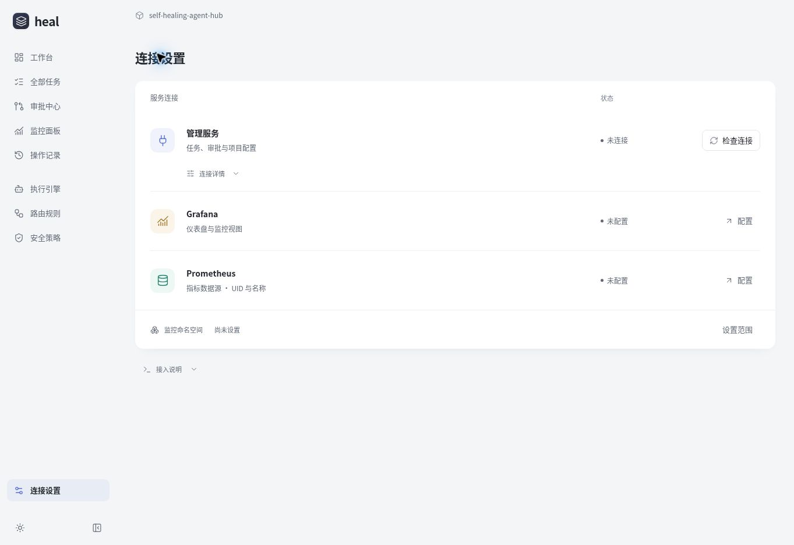
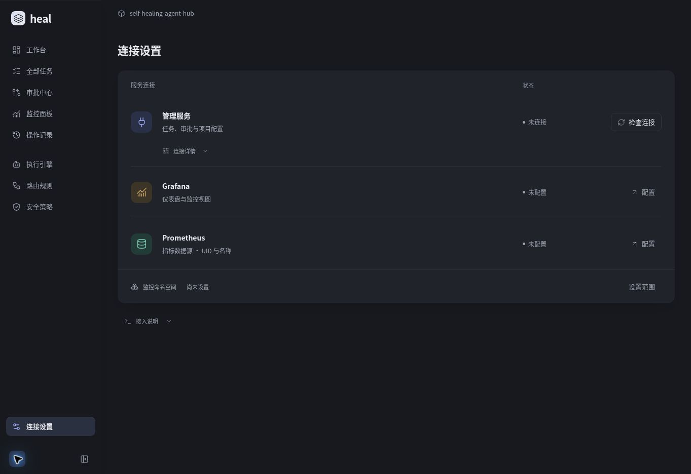
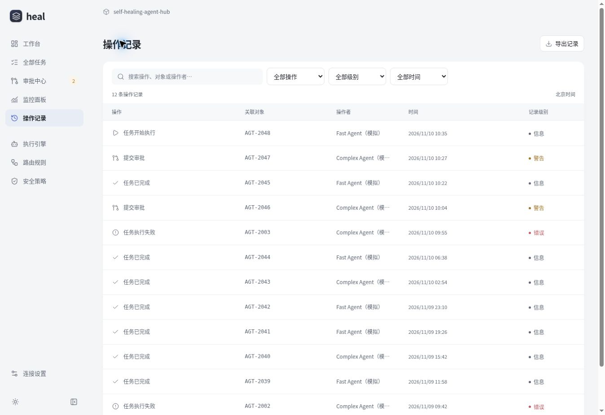
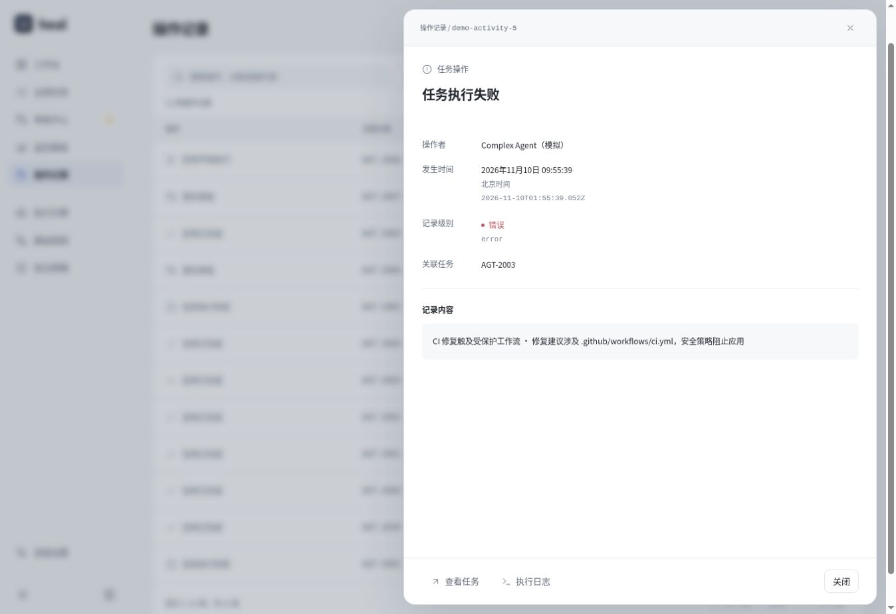

# v10 · 连接设置与操作记录

本轮依据用户提供的实际页面截图，重做连接设置的信息结构与操作记录的阅读方式，同时移除顶部全局任务搜索、模式标记和默认虚构任务。

## 设计变化

连接设置从固定 800px 宽的大型来源卡片，改为与其他页面对齐的服务列表。管理服务、Grafana、Prometheus 使用同一套图标容器、状态、按钮和列间距；面板沿用全站 14px 圆角、无外描边表面与轻阴影。项目、分支、读取时间和接入说明按需展开，避免默认页面出现多层技术说明。

Grafana、Prometheus 和命名空间入口进入原有监控配置页，并分别聚焦服务地址、数据源 UID 和命名空间字段。保存到浏览器的监控配置标为本机／会话草稿，始终说明尚未验证连接或指标；不把字段校验通过当成服务在线。

操作记录由约 84px 的双层条目改为 56px 表格行，固定展示操作、关联对象、操作者、时间和记录级别。长消息、原始时间与关联任务／日志入口进入详情抽屉。信息级别保持灰色，成功、警告和错误仅在源记录明确提供相应 `level` 时使用语义颜色，不依据消息文本或任务动作推断结果。

局部搜索、类型、级别与时间条件取交集，每页 15 条。搜索或改变筛选会回到第一页；导出包含全部匹配记录，不受当前页限制。无连接、已连接但无记录、筛选无匹配是三种不同状态。

## 参考与适配

| 官方参考                                                                                  | 本项目采用的组织方式                                               |
| ----------------------------------------------------------------------------------------- | ------------------------------------------------------------------ |
| [AffectUI Integration Settings](https://www.affectui.com/components/integration-settings) | 服务名称、配置、状态与操作的清晰关系，按需查看详情                 |
| [AffectUI App Directory](https://www.affectui.com/blocks/app-directory)                   | 少量集成采用简短设置列表，避免额外目录、分类或卡片网格             |
| [AffectUI Agent / Activity](https://www.affectui.com/screens/agent-activity)              | 操作先说明发生了什么，完整上下文进入详情，保留可访问名称与键盘入口 |
| [BoardUI Data Table](https://www.boardui.com/components/data-table)                       | 固定列节奏、紧凑行、局部筛选、分页页脚                             |

参考信息层级和交互模式；没有复制付费组件源码或新增 UI 依赖。

## 数据与接入边界

发布构建使用 `npm run build` 的标准同源 API 模式，HTML 中 `console-default-mode` 为 `live`。没有管理接口时维持 `snapshot: null`，不填充任务、日志、配置或成功读取时间。原有开发测试夹具仅通过显式 `?demo=1` 或 `npm run build:demo` 使用，普通界面不提供切换入口。

现有 Node 管理 API、只读配置契约和真实写操作的 `501` 边界保持不变。静态 Site 本身不运行该 Node 服务。任务执行、真实审批、回滚与持久化审计没有因为本次 UI 修改而接通；Grafana 远端连接和指标也没有进行验证。

## 验收 · 2026-11-10

| 检查           | 结果                                                                                                  |
| -------------- | ----------------------------------------------------------------------------------------------------- |
| 完整自动测试   | 180 通过，0 失败                                                                                      |
| 管理记录测试   | 18 通过，覆盖级别筛选、分页边界、全量筛选导出、空值、转义、详情入口和重置行为                         |
| 连接设置测试   | 4 通过，覆盖无演示入口、空连接、草稿来源和外部文字转义                                                |
| 生产构建       | `npm run build` 通过；最终 CSS 调整后标准前端构建再次通过                                             |
| 格式与差异     | 修改文件 Prettier 检查及 `git diff --check` 通过                                                      |
| 桌面与暗色     | 表面 0px 外边框、14px 圆角；操作列左对齐，行高 56px；轻分隔线在明暗主题使用对应 token                 |
| 390px / 1024px | 设置和记录页无页面横向溢出；手机详情框宽 375px，内容宽与滚动宽均 373px                                |
| 连接检查       | 按钮显示检查中、禁用；失败后回到未连接并反馈具体原因；Prometheus 入口定位到 UID 输入框                |
| 键盘与详情     | Enter 打开记录，Escape 关闭并恢复到原记录按钮；关联执行日志可打开                                     |
| 筛选           | 错误级别与 CI 关键词合并后得到 1 条；无匹配时导出禁用；重置恢复完整记录                               |
| 分页与导出     | 使用隔离的开发测试会话生成 16 条记录；第一页 15 条、第二页 1 条；在第二页导出实际 JSON 包含全部 16 条 |
| 独立审查       | 修复空条目位于有效记录之前导致详情查找异常；修复既有契约的显式 success 级别分类；无遗留重要问题       |

详情查找额外执行了实际 `openActivity` 回调：`[null, valid]` 能打开有效记录，缺失数组或快照返回明确提示。测试中使用的规则切换仅发生在独立开发会话中，未更改真实规则。

## 实际页面截图

### 默认连接设置

### 深色连接设置

### 有记录时的布局验收

以下两张使用显式开发测试夹具，仅用于验证有记录时的布局与交互；这些虚构记录不在默认发布页面中加载。

## 交付

沿用原 Site、私有访问范围和原 Draft PR。部署及精确源码提交信息记录在 PR 中；此文件与截图随源码一起保存。

原站点发布已成功，Site 源提交为 `507046c384587fb12475e0da49232b3523d54455`，部署为 `appgdep_6af285680f9c8191b153304a542b6c88`。发布产物使用标准同源 API 模式，未包含临时 QA 页面。
