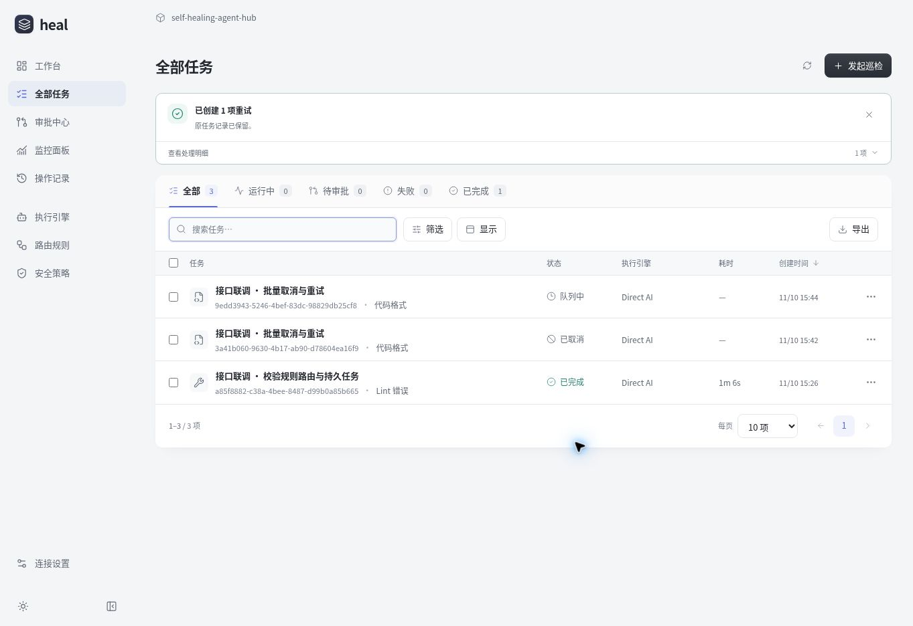
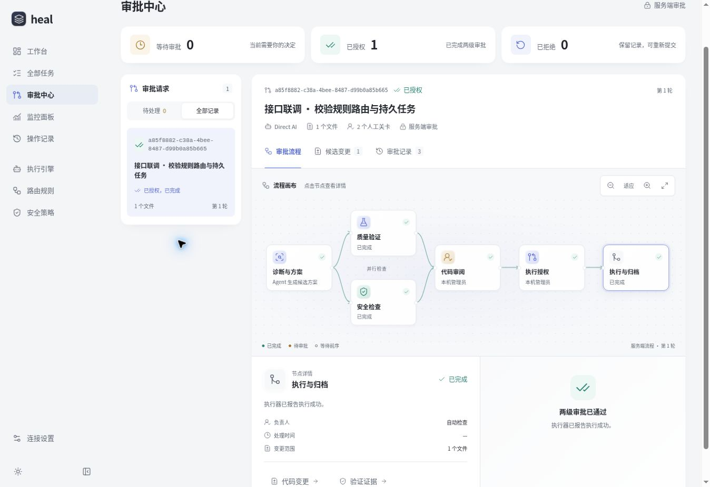

# v11 · 工作台真实接口接入

## 交付范围

本轮把 v10 的现有页面接入仓库内的同源 Node 管理服务，保留视觉体系和页面结构。接口原先只能读取安全配置，写操作返回 501；现在任务、审批、规则开关、监控配置和操作记录都由真实服务端请求驱动，并保存到持久状态文件。

| 页面     | 真实行为                                                               |
| -------- | ---------------------------------------------------------------------- |
| 工作台   | 按服务端任务计算图表，空数据保持空状态                                 |
| 全部任务 | 创建、取消、重试、按版本批量处理；列表和详情读取同一快照               |
| 审批中心 | 提案证据、两级顺序批准、拒绝与重提；执行节点跟随 Worker 回执           |
| 路由规则 | 配置顺序匹配，真实启停影响后续新任务                                   |
| 监控面板 | 服务端保存 UID/name、命名空间和变量映射，检查 Grafana 健康及数据源身份 |
| 操作记录 | 同一事务保存操作者、对象、动作及时间                                   |
| 连接设置 | 管理服务状态、会话登录/退出和监控绑定信息                              |

接口、启动参数及部署见 [管理 API](../console-api.md)，独立执行器接入见 [Agent 协议](../agent-worker-api.md)，使用说明见 [工作台指南](../console-guide.md)。

## 数据与交互决定

- 浏览器写操作等待服务确认，再更新共享快照。网络错误、409 冲突和未登录都给出具体反馈，不自动回退演示模式。
- 创建时锁定输入与提交按钮；审批、批量和配置保存避免重复提交。手动刷新保留当前筛选、选择、详情和未提交草稿；后台刷新避开正在编辑的表单。
- 所有任务写入校验任务版本。配置写入校验快照版本。创建、任务动作和批量操作支持幂等请求 ID，结果不明确时保留 ID。
- 监控检查结果绑定实际检查的配置；并发保存、配置切换和迟到检查不能把 A 的连接状态显示在 B 上。较旧保存响应不能绕过全局快照版本保护。
- 登录切换使旧快照请求失效，避免旧的 401 或 CSRF 覆盖新会话。
- 运行中取消只是请求，必须由 Worker 确认停止。重试创建新任务并保留原结果。失联租约记失败，不自动重新执行外部动作。
- 审批后的执行有独立状态；已完成、失败、取消、跳过都按实际结果展示。创建 Issue 和 CI 重试使用无代码方案及真实诊断证据，不要求伪造 diff 或检查通过。

## 后端实现

持久存储采用单进程写锁、串行事务、临时文件同步与原子替换。损坏状态、写入失败和不安全存储位置会显式报错。物理路径检查包含符号链接，避免私有状态暴露为静态文件。

管理访问与 Agent 访问使用不同令牌。浏览器会话使用 HttpOnly Cookie、同源检查及 CSRF；无令牌模式限制真实本机 socket 与 Host。Worker 租约、服务凭据和原配置秘密不会进入页面快照。

Agent 先领取诊断任务、提交候选与证据，通过两级人工审批后再领取执行阶段。服务校验路由动作、保护路径、文件数、必需检查与最终文件集合；重复文件、越界变更、未经批准的外部结果和带变更的成功跳过均会拒绝。

## 验证记录

### 自动化

验证命令：

```bash
npm test
npm run build
```

本次完整执行结果：**274 项测试通过，0 失败**；类型检查和标准同源 API 构建通过。

测试覆盖真实 HTTP 会话/CSRF、任务重启持久化、版本和幂等冲突、批量部分成功、两级审批、Worker 并发领取/续租/取消/失联、结果校验、Grafana 限时/来源/UID/name 检查、前端迟到响应及草稿保留。

前后端分别经过独立审查，发现的存储符号链接、结果重复文件、跳过夹带外部结果、无代码动作方案、监控并发、登录请求顺序和表单编辑丢失问题均有对应回归用例。

### 实际浏览器

使用独立配置与数据目录，通过真实 Node 服务完成以下操作，未向用户的生产系统发送任务：

1. 页面创建任务，观察提交禁用和服务端生成的任务 ID。
2. 服务重启后重新读取同一任务，验证持久化。
3. 受控 Worker 经 HTTP 领取、回传候选；页面进行两级审批并显示最终执行回执。
4. 在监控页保存 Grafana、Prometheus UID/name 和两个命名空间；检查未允许的 Grafana 地址时明确报错。
5. 切换路由规则后刷新，确认服务端保存的启用状态。
6. 批量选择排队和完成任务，取消请求逐项处理并跳过完成项；重试创建新 ID，保留原取消记录。





执行回执中的代码、提交号和检查结果属于隔离测试夹具，用于验证协议和界面，不代表实际仓库修复、CI 执行或模型调用。

## 部署边界

此版本交付可运行管理服务与执行器协议，仓库尚未提供具体 AI 执行器。生产接入需要部署 Node 服务、配置独立管理/Worker 令牌，并让实际 Agent 按协议运行。已有静态 Site 不能运行此 Node 服务，本轮不把静态托管宣称为已连接生产接口。

Grafana 检查验证服务健康和数据源身份，不查询业务指标、不发现 Kubernetes 命名空间，也不表示 Agent 健康。真实地址、数据源和服务账户由部署环境提供。

当前持久后端为单实例文件存储；Webhook、cron 调度、自动回滚和熔断不属于本轮已实现功能。长期大量任务需要后续迁移数据库并补充归档策略。
